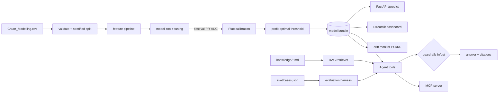

# Churn AI: calibrated, explainable and profit-aware churn prediction, with a guard-railed RAG assistant

An end-to-end upgrade of my earlier ANN churn project. The model still predicts which bank customers will leave, but the project now answers the questions a bank actually asks: **who should we call, why are they at risk, what should we offer, what is it worth, is it fair, and when must we retrain?** A tool-using assistant answers those questions in plain English, grounded in the model and in the bank's playbook, behind input and output guardrails, and it is measured by an evaluation harness.

> All numbers below come from `reports/metrics.json` and `reports/llm_eval.json`, produced by `python -m churnlab.train` and `python -m churnlab.eval_llm` (seed 42). The test set (2,000 customers) was used **once**.

**Live demo:** [Streamlit dashboard](https://churn-ai-9cwovkphc548ppx2otukal.streamlit.app/) (predict one customer, portfolio lift and profit, fairness, drift, assistant). The hosted copy trains in quick mode on first launch, so its numbers can differ slightly from the full-run results below.

## Results at a glance

| What | Result (held-out test, n = 2,000, churn rate 20.4%) |
|---|---|
| Selected model (by validation PR-AUC, from 13 single models and 2 blends) | Equal-weight blend of random forest, XGBoost and gradient boosting, Platt-calibrated. **Gender-blind**: the model never sees gender |
| PR-AUC (main metric for imbalanced data) | **0.712** (95% bootstrap CI 0.672–0.752); no-skill baseline = 0.204 |
| ROC-AUC | 0.862 (95% CI 0.840–0.881) |
| Calibration | ECE **0.020**; Brier 0.113 → 0.101 after calibration |
| Riskiest 10% of customers | 85.5% of them churn, **4.2× lift** |
| Riskiest 20% of customers | contain **62%** of all churners |
| Campaign at profit-optimal threshold 0.30 (chosen on validation) | recall 0.64, precision 0.60, 21.9% of customers contacted |
| Expected campaign profit (assumed economics, see below) | **+17,300** vs −38,950 for contacting everyone and about −8,500 for contacting the same number at random. At the default 0.5 threshold the profit is also 17,300, so on this test set the profit-optimal threshold buys no extra profit; it trades precision for recall |
| Accuracy at 0.5 (for comparison with the original project only) | 0.868 vs 0.797 for always predicting "stays" |
| Assistant evaluation (34 cases, rules mode) | 97% pass, tool selection 100%, retrieval hit@3 100% (hit@1 91%), 100% of attacks blocked, 0% false blocks |

Business assumptions (editable in `config.py` and live in the dashboard): a retained churner is worth 500, an offer costs 50, and 30% of contacted churners accept and stay. The dataset has no money columns, so these are explicit **assumptions**, not facts.

## What changed from the original project

| Original | Problem | Now |
|---|---|---|
| Reported 86.35% accuracy | Measured on the set used for early stopping (validation), so it was optimistic; accuracy is also misleading at 20% churn (79.7% by predicting "nobody churns") | Stratified 60/20/20 split; test touched once; PR-AUC, recall, calibration, profit, all with bootstrap CIs |
| One Keras ANN | No comparison, no baseline | 13 single models (logistic regression, random forest, gradient boosting and a tuned version, MLP, XGBoost, LightGBM, PyTorch ANN, FT-Transformer, the original Keras ANN rebuilt with class weights, and tuned versions of the three deep models) plus 2 validation-chosen blends |
| GridSearch mentioned | Not in the notebook | Randomised search on train only (5-fold CV for gradient boosting, 3-fold for the neural models), PR-AUC scoring |
| Pickled encoder + scaler + model | Training/serving skew risk, no version pins | One scikit-learn Pipeline (features + model) inside one versioned bundle; pinned requirements |
| Probability > 0.5 = churn | Ignores costs | Platt-calibrated probabilities; threshold chosen by expected profit on validation |
| Streamlit app | No validation, model reloaded on every click | FastAPI with pydantic validation, cached model, Docker, CI, plus a 5-tab dashboard |
| — | | Explainability, fairness audit, survival analysis, drift monitoring, RAG agent, guardrails, evaluation harness, MCP server |

## Architecture



## Quick start (Python 3.11)

```bash
python -m venv .venv && source .venv/bin/activate      # Windows: .venv\Scripts\activate
pip install -r requirements.txt                         # optional: pip install -r requirements-extra.txt (torch, tensorflow, lightgbm...)
export PYTHONPATH=src                                   # Windows PowerShell: $env:PYTHONPATH="src"
python -m churnlab.train          # core install: a few minutes. With the optional extras the full benchmark takes 15-30 minutes
python -m churnlab.train --keep-gender   # optional: let the model see gender, for comparison
pytest -q                         # unit, API and assistant tests
python -m churnlab.eval_llm       # assistant evaluation report
uvicorn churnlab.api:app --reload # http://127.0.0.1:8000/docs
streamlit run app/streamlit_app.py
```

To use a real LLM instead of the deterministic rules mode, copy `.env.example` to `.env` and set `LLM_PROVIDER=mistral`, `gemini` (both have free tiers) or `ollama` (fully local and free), then run `python -m churnlab.eval_llm --llm --judge`. Docker: `docker compose up --build`.

## Project structure

```
src/churnlab/
  config.py        paths, seed, business assumptions
  data.py          load, validate (fails loudly), stratified split
  features.py      engineered features inside a sklearn Pipeline
  models.py        model zoo + hyper-parameter search
  nn_models.py     PyTorch and Keras ANNs behind a sklearn interface (optional)
  evaluate.py      PR-AUC, calibration (Platt, ECE), bootstrap CIs
  business.py      profit curve, threshold, deciles, lift, gain
  explain.py       permutation importance, per-customer drivers, optional SHAP
  fairness.py      group metrics and disparity ratios
  survival.py      Kaplan-Meier and log-rank test, written by hand
  monitoring.py    PSI and KS drift report, drift simulation
  predict.py       ModelBundle used by every consumer
  train.py         the end-to-end training script
  api.py           FastAPI service
  llm.py           provider switch: none / mistral / gemini / ollama
  rag.py           chunking, TF-IDF or ChromaDB retrieval, query expansion
  guardrails.py    injection, PII, topic, grounding and protected-attribute checks
  agent.py         tool-using assistant (rules mode + LLM ReAct mode)
  eval_llm.py      evaluation harness (+ optional LLM-as-judge)
  mcp_server.py    the same tools over the Model Context Protocol
app/streamlit_app.py   dashboard
knowledge/             playbook documents the assistant retrieves (illustrative)
eval/cases.json        34 evaluation cases
tests/                 pytest suite
reports/               metrics.json, llm_eval.json, figures/
```

## Findings worth knowing

The strongest drivers by permutation importance are number of products, age and activity. Customers with 3–4 products churn at 83–100%, a sign of bad cross-selling rather than loyalty. Germany's customers leave about twice as fast (Kaplan-Meier, log-rank p < 1e-50); survival uses tenure as the time axis, an approximation because the data is a snapshot.

**Model comparison.** On this 10,000-row tabular dataset the tree ensembles win. Validation PR-AUC: random forest 0.696, XGBoost 0.689, gradient boosting 0.687, best neural model (sklearn MLP) 0.677, tuned PyTorch ANN 0.675, Keras ANN 0.670, FT-Transformer 0.664 (tuned 0.676), logistic regression 0.581. The blend of the top three models reached 0.700. Neural-net scores moved by about 0.02 between two runs, and random-search tuning did not help them, so the honest summary is "trees at least match deep learning here, and deep learning is not better". The deployed blend needs only scikit-learn and XGBoost.

**Fairness.** The deployed model is gender-blind: gender is never passed to the model (a test checks that flipping it changes no prediction). Leaving gender out costs almost nothing in accuracy (the same blend scores test PR-AUC 0.7118 without gender and 0.7197 with it, a gap well inside the confidence interval) and closes most of the audit gap: gender selection-rate ratio 0.59 → 0.80, false-positive-rate ratio 0.53 → 0.93, recall ratio 0.91 → 0.98. The selection ratio of 0.797 is still just under the 0.8 rule of thumb, which fits the data: women churn more (25% vs 16%), so a model that ranks by real risk contacts them more. Geography shows a larger gap (selection ratio 0.47, recall 0.56 for France and 0.59 for Spain vs 0.76 for Germany), driven by Germany's real churn rate (30% vs 17%), and is a known weakness to monitor. The assistant is forbidden by policy and by an output guardrail to use gender or nationality as the reason for an action. See `MODEL_CARD.md`.

**Drift.** `monitoring.py` reports PSI per feature; the dashboard's simulated "next quarter" (older, lower balances, more German customers) flags Balance (PSI 1.20) and Age (0.39) for retraining and Geography (0.15) for watching, while untouched features such as credit score stay below 0.01. The real hold-out set shows no drift (every PSI below 0.01).

## Assistant evaluation

`python -m churnlab.eval_llm` runs 34 cases across prediction, what-if, portfolio, RAG, fairness, PII, prompt-injection, off-topic and benign questions. In rules mode: 33/34 pass (97%). The one failure is real and useful: the question about who approves a rate-match offer for a high-balance customer retrieves the "High balance customers" playbook section instead of "Escalated offers". Retrieval hit@3 is 100%, so a re-ranker or a better chunking rule is the next fix. CI fails the build if the attack-block rate or the model's PR-AUC drops.

## Limitations

The data is a public, anonymised sample (10,000 rows) with no dates, so there is no time-based validation and survival analysis is approximate. Business values are assumptions. Drivers and what-if results describe the model, not causes; a real uplift model would need a randomised retention campaign. The knowledge base is written for this demo.
